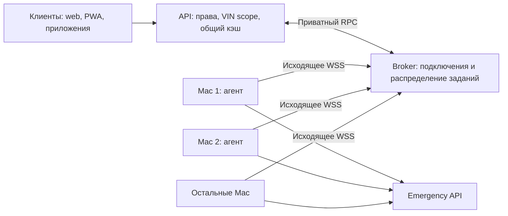
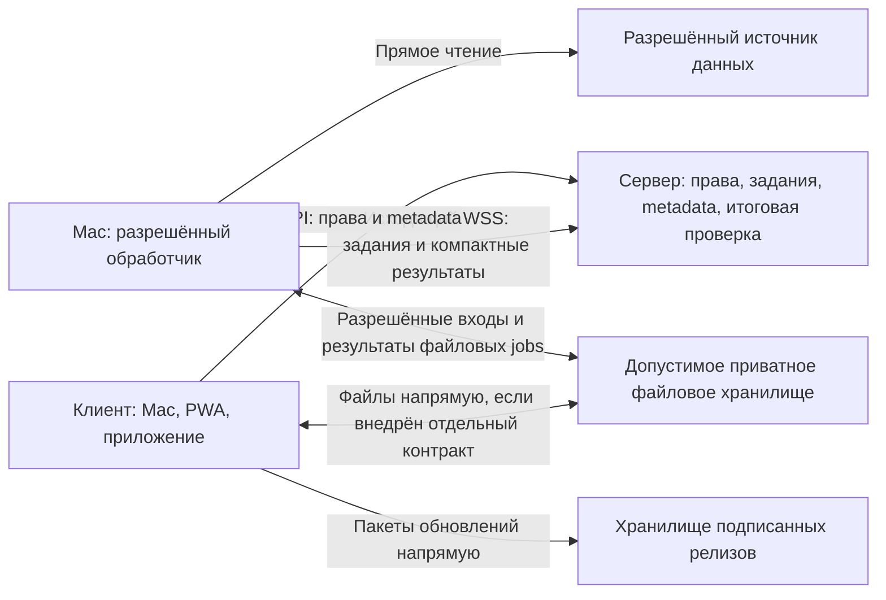

# Robopark: исходящий сервис macOS и распределённый доступ к Emergency

Дата: 13 октября 2026, Europe/Moscow.
Статус: реализация возобновлена по запросу пользователя 13 октября. Подготовлен
первый тестовый срез: отдельный broker, Swift agent и сборщики Linux OTA/macOS
pkg. Этот документ сохраняет целевую архитектуру; не все её пункты входят в
первый выпуск. Реальный состав и ограничения перечислены в
[инструкции тестового релиза](../runbooks/test-release.md), результаты — в
[отчёте проверки](../verification/2026-10-13-macos-test-release.md).

Пользователь выберет тестовое устройство позже и предоставит SSH либо установит
систему самостоятельно. Этот запуск не разворачивает релиз на физических платах
или production. Предыдущее указание отложить разработку заменено запросом
подготовить тестовый релиз с установщиком Mac.

## 1. Актуальные требования пользователя

- Число работающих сотрудников меняется от **0 до 100**. Число сотрудников,
  browser-сессий, зарегистрированных Mac и готовых агентов — разные величины.
  Первое измерение масштаба — до 100 одновременно подключённых агентов;
  несколько устройств одного сотрудника учитываются отдельно.
- Уже при **двух** пригодных Mac нужен автоматический выбор лучшего исполнителя.
  При большей нагрузке задания распределяются по всему пригодному пулу.
- Корпоративная сеть или авторизация Emergency может пропасть при работающем
  интернете и живом соединении агента с Robopark. Такой Mac сразу исключается
  из выбора для соответствующих операций.
- На Mac сервис и локальная панель устанавливаются **одним подписанным `.pkg`**.
  Скрипты настройки находятся внутри пакета; пользователь не собирает папку
  из файлов и не устанавливает среду разработки.
- Визуальный сайт может исчезнуть. Целевые клиенты допускают приложение/PWA
  у механиков и macOS-приложение у остальных. Это возможное развитие, а не
  поручение сейчас переписать все клиенты. API, обновления и агент независимы от UI.
- При запуске проверяется актуальная версия и предлагается «Обновить» / «Позже».
  **Автоматическая проверка не означает установку без выбора пользователя.**
  Версии и карта каналов приходят с сервера и могут меняться ежедневно.
- Нужны шифрование, защита целостности поставки, ограниченная работа офлайн
  и сохранение локальных данных при обновлении. Границы защиты от владельца
  Mac и администратора ОС явно указаны ниже.
- Mac сам подключается к серверу по существующему HTTPS-адресу. **Новые порты,
  домены или туннели Tuna создавать не требуется. Tuna на Mac не устанавливается.**
- Регистрация устройства сохраняется; штатные reconnect и смена исполнителя
  проходят автоматически. Корпоративный SSO может отдельно потребовать входа.
- Снижать нагрузку нужно измеримо. Первый распределяемый тип работы — чтение
  Emergency; остальные задачи добавляются отдельными контрактами.
- Уточнённая топология: **сервер подключён по Wi-Fi, Mac сотрудников находятся
  в разных сетях**. Нужно использовать их вычислительные ресурсы и собственные
  каналы связи, отдельно сокращая объём данных через Wi-Fi сервера.

Эти требования заменяют прежнее предложение о четырёх фиксированных Mac,
динамическом распределении «потом» и обязательной нативной оболочке.
Ранее предложенные алиасы `robopark-emg-1`…`robopark-emg-4` для этой схемы не нужны.
Приложенный `emergency-mac-tunnels-concept.html` используется как исторический
источник ограничений, а не инструкция сохранять TCP-топологию.

## 2. Архитектура

Стрелки WSS показывают инициатора соединения. Канал двусторонний: сервер
отправляет по уже установленному соединению конкретное задание, Mac выполняет
его в корпоративной сети и возвращает результат. Серверу не нужен публичный
IP Mac, входящий listener на ноутбуке или отдельный туннель к нему.

Предлагаемый endpoint: `wss://<origin-api-Robopark>/api/emergency/bridge/ws`.
Это новый маршрут существующего сервера, а не новый публичный порт.
Существующий Tuna-туннель сайта, если он обеспечивает этот origin, остаётся.
«Без дополнительных туннелей» не означает автоматического удаления Tuna
из текущей инфраструктуры сервера. Текущий HTTPS origin можно сохранить даже
при удалении визуального сайта: API и reverse proxy остаются серверными службами.

Документация Tuna подтверждает WebSocket в HTTP-туннелях. В deployment Robopark
нужно добавить отдельный nginx location с Upgrade перед общим `/api/`, проверить
timeout, buffering и длинные соединения. Текущая общая API-настройка не является
доказательством готовности нового WSS-маршрута.

Границы компонентов: серверное API и broker → агент macOS → пользовательский
клиент. Каталог обновлений, регистрация и авторизация — API-контракты, а не
разбор HTML сайта. Reverse proxy и каталог release не должны зависеть от
контейнера визуального frontend. Новый клиент использует те же права, данные
и протоколы; native-оболочку можно добавить поверх существующего агента.

## 3. Установка одним файлом

Пользователь скачивает и открывает **`Robopark-<version>-arm64.pkg`**.
Пакет содержит готовый агент, локальную панель и необходимые ресурсы, описание
LaunchAgent и скрипты настройки. Отдельная папка, `.env` или второй установщик
не требуются. «Один файл» относится к поставке: после установки рабочие файлы
размещаются в стандартных системных каталогах.

Предпочтительная защищённая установка: подписанный бинарник и UI-ресурсы в
`/Library/Application Support/RoboparkAgent` принадлежат root и не доступны
обычному сотруднику для записи. Агент работает от зарегистрированного
пользователя через LaunchAgent, а не с постоянными root-полномочиями.
Ключи и пользовательские данные хранятся отдельно от исполняемого кода.
Настройка автозапуска привязана к выбранной пользовательской сессии.

Целевая платформа первого выпуска — Apple Silicon, macOS 13+.
Язык бинарника выбирается после проверки корпоративной авторизации и Keychain.
От оператора не требуются Python, Node, Docker, Xcode или открытый Terminal.
Сервис работает от пользователя. Установка и замена защищённых файлов могут
потребовать стандартного подтверждения администратора macOS; обещать полностью
беззапросную установку в системный каталог нельзя. Постоянный root-daemon,
принимающий произвольные команды, не добавляется.

Скрипты внутри pkg проверяют платформу, идемпотентно размещают файлы,
настраивают автозапуск и открывают настройку. Origin API и доверенные ключи
поставляются проверенной конфигурацией пакета; первый запуск требует
одноразовую привязку устройства. Смена origin проходит через подписанную
конфигурацию с проверкой доверия, а не произвольное изменение сотрудником.
Корпоративный вход остаётся интерактивным, если его требует SSO: скрипт не может
выдать недостающий доступ, сертификат или автоматически выполнить MFA.

Локальная панель слушает только `127.0.0.1`, предлагаемый порт — `18444`.
Он не доступен из сети и не публикуется в Tuna. Управление защищено локальной
сессией, проверкой Host/Origin и CSRF; первая сессия создаётся одноразовым
локальным сопряжением. Постоянные секреты не передаются в URL, логи или JS.
Удалённый web/PWA-клиент не делает автоматических browser-запросов к localhost.
Будущий macOS UI взаимодействует с агентом через ограниченный локальный API.

После настройки браузер и Terminal можно закрыть. Блокировка экрана и доступ
к Keychain проверяются на пилоте. Сон, выключение или выход из macOS делают
агента недоступным. После пробуждения он заново проходит проверку связи и
Emergency. Принудительное удержание от сна по умолчанию не включается.

Обновление сохраняет регистрацию, проверяет новый release, завершает или
отменяет текущие задания, переключает версию и допускает откат. Удаление снимает
свой LaunchAgent, отзывает регистрацию и удаляет только собственные файлы.
Бинарники подписываются Developer ID Application, pkg — Developer ID Installer;
поставка проходит notarization. Скрипты внутри пакета покрываются целостностью
пакета. Gatekeeper не отключается. `.pkg` не требует разработки отдельного
нативного оконного приложения для первой версии сервиса.

## 4. Пул и распределение работы от 0 до 100

| Число пригодных для запроса агентов | Поведение |
|---|---|
| 0 | Проверенный direct path, если он доступен; иначе допустимый stale или явная временная недоступность |
| 1 | Задания получает этот Mac в пределах его лимита; резерв из Mac отсутствует |
| 2 | Выбор лучшего исполнителя каждого задания; при параллельной работе может использоваться второй; автоматическая замена при сбое |
| 3–100 | Распределение заданий по всему пригодному пулу с учётом загрузки и качества каждого пути |

Это количество агентов, а не сотрудников в открытом интерфейсе. Даже при нуле
открытых browser-сессий включённый и допущенный Mac может оставаться исполнителем.
Один установленный агент ещё не означает, что он доступен и авторизован.

Перед выбором проверяются допуск устройства, актуальность соединения,
совместимость протокола, свежий успешный запрос Emergency, корпоративные
полномочия для нужного VIN и отсутствие текущего auth/network отказа.
Неподходящий scope нельзя компенсировать высокой скоростью устройства.

Среди пригодных Mac scheduler оценивает ожидаемое время выполнения: задержку
успешных запросов по сглаженной статистике, ошибки и разрывы за окно,
число текущих заданий и разрешённую ёмкость устройства. Это выбор по наблюдаемому
качеству, а не обещание знать самый быстрый Mac без измерения.
Сглаживание оценок и проверка восстановившегося агента предотвращают постоянные
переключения из-за единичных колебаний. Неисправный путь исключается сразу.

Постоянного «главного ноутбука» нет. При низком потоке часть агентов может
простаивать; при росте нагрузки scheduler использует остальных. Равное число
заданий каждому не является целью, если устройства имеют разную доступность
или производительность. Настройки Mac включают паузу участия и предел
параллелизма; режим экономии батареи может уменьшать доступную ёмкость.

**Один запрос — один исполнитель.** Рассылка одного задания всем Mac запрещена.
Одинаковые запросы VIN объединяются общим серверным кэшем/single-flight.
Предпочтение ранее использованного Mac допустимо только пока он здоров и
не перегружен. Проверки кандидатов распределяются во времени и ограничиваются
общим бюджетом, чтобы 100 ноутбуков не опрашивали Emergency одновременно.

Стартовые параметры для последующего измерения: heartbeat 10 секунд с jitter,
свежесть готовности до 30 секунд, максимум 2 задания на Mac, общий deadline
чтения 20 секунд. Это проектные значения, а не измеренные гарантии скорости.
Системные лимиты broker и очередей фиксируются нагрузочным тестом.

## 5. Отказ и восстановление

Связность и upstream-состояние учитываются отдельно: `connected`,
`emergency_ready`, `auth_required`, `network_unavailable`, `paused`, `revoked`.
Открытый WSS или успешный heartbeat не доказывает доступа к Emergency.
Результаты реальных чтений обновляют upstream-состояние; отдельные probes
выполняются по ограниченному расписанию и только с допустимым VIN.

При потере корпоративного доступа агент уведомляет broker, когда это возможно;
ошибка текущего запроса также немедленно исключает путь. Смена Mac не требует
смены порта, DNS или освобождения Tuna-слота. Агент с восстановившимся доступом
возвращается после свежей успешной проверки.

Общий deadline включает очередь, cache coordination, сеть и выполнение.
На один запрос допускаются **не более двух provider attempts всего**:
первый исполнитель и один резерв — другой Mac либо проверенный direct path.
Третья попытка через direct после двух Mac не добавляется. Повторяется только
разрешённое чтение; после timeout upstream мог уже выполнить первое чтение.

Отказ SSO исключает соответствующую credential generation. Другой Mac может
принять запрос только при подтверждённом доступе в тот же допустимый scope.
Запрет полномочий нельзя обходить подбором более привилегированного агента.
Корректная ошибка состояния робота не является отказом сети.

При разрыве агент reconnect-ится с exponential backoff и jitter. Broker
присваивает новую connection generation и закрывает предыдущее соединение
того же устройства. Запрос связан с `job_id`, `attempt_id`, `broker_epoch`,
`connection_generation` и `authority_generation`. Отменённый, просроченный,
чужой или старый ответ не завершает новый запрос и не попадает в кэш.
При перезапуске broker меняет epoch, агенты регистрируются заново; очередь
устаревшей телеметрии после восстановления не проигрывается.

## 6. Серверный broker и существующий код

Проверено чтением текущего проекта на 13 октября:

- API запускается в нескольких Uvicorn worker; production-профиль рассчитан
  на 2–4 процесса. Их память и активные WebSocket не общие.
- `live_merge` координирует результаты/ожидание через файлы, а не соединения.
- Emergency client выполняет cookie-based GET с внутренним CA и timeout
  30 секунд; cache fresh TTL 3 секунды, stale до 60 секунд, предел 512 записей
  и 16 MiB. В старой миграционной документации TTL 2,5 секунды устарел.
- Текущий предел Emergency — 8 запросов на API worker, не на весь сервер.
- Пользовательские маршруты проверяют доступ, `nav.emergency` и Tracker VIN scope.
- Cookie guard, keepalive и интеграционные статусы пока не знают об агентах.

Предлагается отдельный single-instance `emergency-bridge-broker` на текущем
хосте. Он владеет всеми WSS, учётом нагрузки, ограниченными очередями и pending
jobs. API workers после RBAC/VIN scope обращаются к нему по приватному RPC
(Unix socket либо защищённая внутренняя сеть контейнеров) с общим deadline.
Активные каналы не хранятся независимо в каждом API worker.

Публичный WSS-маршрут проксируется прямо к broker. Persistent DB хранит
регистрации, публичные ключи, отзыв, scope и аудит. Краткоживущие каналы,
heartbeats и ожидающие задания принадлежат broker; каждый heartbeat не должен
превращаться в обязательную отдельную запись в SQL.

У broker отдельные лимиты handshake, входящих сообщений, сырого payload,
параллелизма и общей очереди. Текущий лимит API WebSocket 16 KiB нельзя
автоматически считать достаточным для Emergency JSON. Превышение очереди
возвращает управляемую перегрузку; очередь не растёт без границ.

Синхронный provider adapter ожидает RPC в пределах deadline, освобождая DB
connection до ожидания. Ошибка broker не зависает навсегда в waiter кэша.
Сам broker — явная единичная точка отказа первого deployment: restart,
reconnect, verified direct и допустимый stale предусмотрены, кластерная HA
этим проектом не заявляется.

## 7. Авторизация и границы данных

У каждого агента собственный ключ в Keychain и отзываемая регистрация.
Enrollment выполняется одноразовым кодом с hash, сроком и атомарным погашением.
При подключении broker проверяет подпись свежего challenge и текущие права
устройства. Долгоживущие секреты не передаются в query string, логи или JS;
общий ключ на всех сотрудников и browser cookie в роли agent credential
не используются. Handshake до авторизации имеет короткий timeout и rate limit.

Агент принимает фиксированную операцию `robot_payload(normalized_vin)` и сам
строит GET к разрешённому Emergency origin. Произвольные URL, методы, заголовки,
команды shell и cookies от сервера не исполняются. Redirect не пересылает
секреты в другой origin; размер ответа ограничивается до разбора всего JSON.
Сервер проверяет формат, VIN, связь ответа с заданием и допустимые поля.

Три состояния независимы: регистрация агента, browser-вход пользователя
в Robopark и корпоративная сессия Emergency. Действующая browser-политика —
3 дня бездействия / максимум 30 дней. Длительный browser-вход — отдельная
серверная доработка и не условие работы агента. Сохранение ключа устройства
не отменяет истечение SSO, смену прав и MFA Emergency.

WSS обеспечивает TLS до существующего HTTPS origin. Если TLS завершается
у Tuna, это не end-to-end mTLS до broker; такой proxy входит в границу доверия
и потенциально видит передаваемые данные. Отсутствие кадров в инспекторе не
доказывает криптографическую недоступность данных посреднику. Перед production
проверяется фактическая TLS-цепочка: если посредник не входит в допустимый
контур, нужны TLS до собственного origin либо отдельно проверенное сквозное
шифрование протокола между агентом и broker. При сохранении TLS-терминации
на посреднике целевой вариант для приватных payload — проверенный протокол
защищённого канала поверх WSS с аутентификацией обоих концов, свежими ключами
сессии и защитой от replay. Конкретная поддерживаемая реализация выбирается
до исполнения; собственная криптографическая схема не разрабатывается.
Подпись challenge сама по себе не шифрует payload. Выпуск нельзя считать
защищённым этим дополнительным слоем до его реализации и проверки.

Исходящее соединение уменьшает публичную поверхность Mac, но не заменяет
проверку заданий. Endpoint сервера и локальная web-панель требуют защиты.
Права, БД, аудит и окончательная выдача пользовательского ответа остаются
централизованы; личная сессия Mac не даёт платформе автоматически чужие права.

### Защита от изменения и просмотра

Поставка содержит скомпилированный агент без исходного проекта и отладочных
символов. Code signing, Hardened Runtime, root-owned установка и подписи
обновлений защищают происхождение и затрудняют подмену обычным пользователем.
Секреты хранятся в Keychain; локальные приватные данные шифруются стандартным
аутентифицированным шифрованием с ключом из Keychain, отдельно для учётной
записи/экземпляра. UI не показывает секреты и внутренние адреса без необходимости;
диагностические логи очищены от них.

Полностью скрыть клиентский код, сетевые адреса или данные во время использования
от владельца Mac с admin/root правами невозможно. Web/PWA-код также доступен
клиенту. Минификация, шифрование строки адреса или binary packing не считаются
границей безопасности. Более строгий контроль требует управляемых устройств
и ограниченных пользовательских прав; это отдельное организационное условие.

Самоотчёт клиента «версия X, подпись верна» не доказывает, что запущен
неизменённый бинарник. Broker проверяет свои permissions, ключи, scope,
протокол, лимиты и контракт результатов. Device key доказывает владение ключом,
но не является аттестацией кода и не доказывает истинность телеметрии, если
сам Mac скомпрометирован. Критические действия не авторизуются только по данным
одного такого исполнителя; проверка формы JSON не подменяет доверие к источнику.

## 8. Кэш и объём распределяемой нагрузки

Сохраняются fresh TTL 3 секунды и предельный возраст stale 60 секунд.
Общий namespace: версия схемы + подтверждённый upstream authority profile +
authority generation + VIN. Между Mac кэш общий только при подтверждённой
эквивалентности полномочий. Entry сохраняет provenance: исходное устройство,
credential generation и время получения upstream; перепаковка не омолаживает данные.

Ответ от отозванного источника или недействительной credential generation не
выдаётся как stale. Смена общего scope инвалидирует соответствующий namespace.
Потеря SSO одного Mac не означает автоматически потерю SSO остальных устройств;
состояния источников и их разрешённые поколения учитываются отдельно.
При auth failure нельзя скрывать отказ показом старых данных того же источника.

Первый этап распределяет запросы Emergency и связанные upstream-соединения.
Сервер продолжает выполнять нормализацию, диагностические правила и RBAC.
Распределение по Mac не уменьшает само по себе количество необходимых чтений
Emergency; это делает общий кэш и дедупликация. Дополнительные probes ограничены.

### 8.1. Дополнительные вычисления на Mac

Агент можно развивать в пул исполнителей конкретных типов заданий. При этом
корпоративный доступ и вычислительная готовность независимы: Mac без Emergency
может выполнять разрешённый расчёт над уже доступными ему данными. Права
сотрудника не расширяются из-за назначения машины исполнителем. Секретные
данные нельзя отправлять на чужой Mac только потому, что у него свободен CPU.

Предлагаемые направления, а не уже реализованные возможности:

| Задача | Где выполнять | Ожидаемый эффект и ограничение |
|---|---|---|
| Чтение Emergency | На подходящем Mac с корпоративным доступом | Распределение соединений и устойчивость к потере доступа; при возврате полного ответа трафик сервера почти не сокращается |
| Подготовка фото и превью | На устройстве, где появился исходный файл | Меньше upload bytes; пересылать исходник через сервер на другой Mac ради сжатия невыгодно |
| Формирование PDF/таблицы для пользователя | Локально у пользователя по разрешённому снимку | Разгрузка рендеринга; выгоды по сети нет, если сначала требуется скачать больший набор исходных данных |
| Разбор больших логов, агрегации, OCR | На допущенном Mac, желательно рядом с источником | Потенциально меньше CPU и трафика сервера, если вход поступает напрямую, а результат мал; отдельный контракт и benchmark |

Для расчётных jobs scheduler сначала фильтрует по типу операции, версии
обработчика, правам, доступности входа и лимитам. Затем оценивает время очереди,
передачи входа, вычисления и возврата результата. Предпочтение уже имеющему
разрешённый снимок исполнителю уменьшает повторную пересылку. «Самый мощный Mac»
не всегда быстрее Mac с локальными данными и свободным каналом.

Пилотная политика: максимум одна тяжёлая фоновая задача на Mac, по умолчанию
только при внешнем питании, с ограниченным объёмом памяти и низким приоритетом.
При thermal/memory pressure или активной нагрузке сотрудника новые тяжёлые
задания не назначаются; доступна пауза участия. Emergency имеет отдельный
приоритет и зарезервированную ёмкость. Конкретные CPU/RAM/сетевые лимиты выбираются
после измерений; фиксированный процент без реализации ограничения не обещается.
Потеря возможности считать не означает автоматически потерю Emergency-доступа.

Новые jobs имеют фиксированный versioned тип, scope, snapshot/hash входа,
deadline, lease и идемпотентный ID. Результат принимается только для действующей
попытки; после потери исполнителя допускается повторное выполнение, а не двойная
фиксация результата. Для длительных расчётов checkpoint возможен только при
поддержке самим обработчиком. Политика повторов каждого типа задаётся отдельно;
существующий общий предел двух попыток Emergency не расширяется.

Критические изменения, БД, RBAC и аудит остаются на сервере. Агент не исполняет
произвольный код, SQL или shell из задания. Результаты с пользовательских Mac
не становятся доверенными только из-за подписи устройства. Проверка формата
не доказывает правильность расчёта; контракт определяет проверяемые инварианты
и допустимое применение результата. Локальный AI — отдельный эксперимент с
совместимыми runtime/model, разрешёнными данными и измерением памяти/энергии;
существующий AGX runtime не переносится на Apple GPU автоматически.

При нуле исполнителей интерактивный расчёт может выполняться на сервере только
в пределах его бюджета; фоновый остаётся в ограниченной очереди со сроком жизни
или получает явный отказ. Зависимость критических операций от включённого
ноутбука сотрудника не вводится. React уже выполняется на клиенте; смена
оболочки сама по себе не разгружает backend.

### 8.2. Разгрузка Wi-Fi сервера

Mac находятся в разных сетях и могут использовать независимые каналы. Но путь
`источник → Mac → сервер → пользователь` всё ещё переносит результат через
Wi-Fi сервера дважды: при получении и выдаче. Перенос CPU и upstream-запроса
на Mac не объединяет скорости интернет-каналов в один канал сервера.
Схема `сервер → Mac → сервер` может даже увеличить сетевую нагрузку.

Целевые маршруты:

Порядок улучшений:

1. **Раздача обновлений вне сервера.** Distribution API сообщает доверенное
   назначение релиза; `.pkg` скачивается напрямую из хранилища релизов/CDN по
   подписанным metadata. Нельзя просто поставить CDN перед origin и считать
   все origin bytes исчезнувшими: пакет должен быть заранее размещён в этом
   хранилище. Иллюстрация масштаба, не измерение: 100 установок по 100 MB —
   10 GB загрузок клиентами, которые не обязаны проходить через Wi-Fi сервера.
   Выбор «Обновить/Позже», подписи и независимость от визуального сайта сохраняются.
2. **Сжатие у источника и устранение повторных передач.** В текущем offline
   media pipeline уже есть попытка resize фото до 1920 и WebP quality 0.82;
   при недоступности API/ошибке возвращается исходник, поэтому сокращение размера
   не гарантировано. Для legacy multipart report/task flows этот вызов не
   найден. Сначала унифицировать подготовку именно фотографий с проверкой
   читаемости и фактического размера. Документы/доказательные оригиналы не
   перекодировать автоматически. Существующие ETag, gzip и offline cache учитывать
   как уже имеющиеся оптимизации, не приписывать их новому агенту.
3. **Крупные приватные файлы напрямую в разрешённое хранилище.** Сервер выдаёт
   короткоживущий доступ к конкретному объекту/методу после проверки прав,
   контролирует квоты и принимает metadata после проверки размера/checksum.
   Политика хранилища запрещает перезапись принятой версии; сервер фиксирует
   уникальный object ID и точную версию, не только изменяемый ключ. Ссылка
   является секретом и может повторно использоваться
   до истечения; её нельзя считать одноразовой или мгновенно отозванной при
   logout. Нужны ограниченный TTL, политика отзывов, очистка, допустимое размещение
   данных и совместимая схема шифрования. S3 presigned URL — пример механизма,
   не выбор провайдера и не существующая возможность Robopark.
4. **Компактные результаты и подписки.** Для новых вычислительных jobs возвращать
   результат вместо всего исходного набора. Для Emergency первая версия сохраняет
   текущий полный контракт; сокращённая проекция/delta допускается только отдельной
   версией с проверкой диагностических правил, базовой версии и восстановлением
   полного снимка. Нельзя молча отбросить поля, на которых зависят статусы.

Сейчас файлы принимаются API, хранятся на диске сервера, а task attachments
затем загружаются из server staging в Tracker. Даже после direct upload в
хранилище этот последний этап потребует серверного трафика, пока отдельно не
изменена интеграция доставки. Общие Tracker-токены на Mac ради такой оптимизации
не выдаются. Приватное хранилище на том же Wi-Fi сервере сеть не разгрузит.

Новый публичный listener на Mac, TCP-алиасы Tuna и раздача файлов между Mac
не нужны. P2P между разными сетями добавит NAT traversal, возможный relay и
дополнительный контур доступа; в первый выпуск это не входит. Центральный API
остаётся зависимым от связи сервера. Если нужно переживать падение его Wi-Fi
для онлайн-операций, потребуется отдельное решение доступности сервера/канала;
пул Mac сам по себе эту проблему не решает. Перевод сервера на Ethernet, если
физически возможен, убирает именно Wi-Fi участок, но не лимит внешнего uplink.

### 8.3. Как подтвердить пользу

До оптимизаций измерить на одинаковом сценарии: CPU/RSS сервера и Mac,
байты вход/выход сервера по категориям (Emergency, файлы, обновления, UI),
RTT/ошибки, время очереди, p50/p95 ответа, работу от батареи. Считать реальные
bytes интерфейса и application bytes раздельно, не суммировать один поток
повторно на API, proxy и туннеле. Крупные медиа не отправлять по control WSS.
Ограничить общий объём очередей и скорость фоновых передач, оставить бюджет
для интерактивных запросов. Трафик и задержку сети оценивать по реальным jobs,
без постоянных speed tests на сотне устройств.

Существующий host watchdog собирает периодические показатели производительности
и Wi-Fi, а capacity benchmark моделирует задержку/потери. Это не измерение
пропускной способности реального Wi-Fi/Tuna и не подтверждение текущего перегруза.
Пилот сравнивает direct и пул из двух Mac в разных сетях, затем 12 и 100
синтетических исполнителей со stub upstream; физический пилот проводится отдельно.
Перенос считается полезным, если улучшает целевой CPU/latency/bytes показатель
без недопустимого ухудшения других. Процент ускорения заранее не обещается.

## 9. Проверка обновлений и предложение установки

Источник — versioned distribution API на сервере, доступное независимо от
визуального сайта, например `/api/distribution/v1/...`. Клиент не анализирует
HTML страницы загрузки и не вычисляет «новый выпуск» прибавлением номера RC.

Сообщение пользователя «сейчас стабильная rc.43, тестовая rc.44» — снимок на
13 октября, не константы программы. Публикуемая карта каналов меняется ежедневно.
Канал имеет устойчивый ID, отображаемое название и подписанное назначение
конкретных артефактов; добавление/переименование не требует переустановки клиента.
Канал устройства назначается политикой admin/royal. Исчезновение канала не
переключает сотрудника на произвольный тестовый: остаётся последняя допустимая
версия и сообщается необходимость нового назначения.

В текущем коде host OTA каналы фиксированы как `stable`, `rc`, `manual`, а
RC-релизы разрешены только в `rc`. Поэтому «стабильный для команды rc.43» нельзя
молча выдать за технический `stable` старого updater. Для агентской distribution
policy нужен отдельный явный контракт назначения проверенной сборки, совместимый
с публикацией компонентов; правила старого host OTA не обходятся.

При старте агента, а также после возвращения сети выполняется проверка с
ограниченным timeout и backoff. Работа установленной версии не ждёт ответ
каталога. Повторные служебные перезапуски не открывают по одному окну каждый раз:
предложение и выбор «Позже» сохраняются для конкретного release ID.
Периодическая фоновая проверка может сообщать о ежедневных выпусках, но не
устанавливает их автоматически. Пользователь также может запустить проверку вручную.

Последовательность:

1. Получить и проверить подписанные metadata, выбранный канал, целевую платформу,
   поддержку установленного backend и текущего протокола.
2. Если совместимого обновления нет — продолжить работу. Если каталог недоступен
   или metadata недостоверны — сохранить рабочую версию, показать состояние проверки.
3. При наличии показать установленную/новую версии, изменения и размер,
   действия **«Обновить» / «Позже»**. Предложение доступно в локальном UI;
   уведомление macOS используется только при разрешении ОС. Его наличие не
   зависит от открытого сайта.
4. После «Обновить» скачать пакет, проверить подпись metadata, hash/размер
   артефакта, Developer ID/Team ID, целостность и разрешённый переход версии.
   Недоверенный пакет не исполняется. Для защищённой системной установки
   запускается стандартный Installer с его запросом прав, если требуется.
5. Перевести агент в `updating`, прекратить выдачу новых заданий этому Mac,
   завершить/отменить текущие в общем бюджете. Остальные Mac продолжают работу.
6. Установить согласованный набор бинарника и локального UI, сохранить ключи,
   регистрацию, черновики и совместимую схему локальных данных. Запустить
   проверку здоровья; при неудаче вернуть ранее проверенную версию и данные.

Root trust для обновлений закреплён в подписанном установщике. Metadata
подписывают release ID, component/platform/arch, версии, URL, hashes/размеры,
совместимость, канал, номер поколения и срок действия. Нужны защита от replay,
freeze/downgrade и поддерживаемая ротация ключей; предпочтителен проверенный
TUF-клиент либо эквивалентный отдельно проверенный контракт. Закрытый ключ
выпуска не размещается на сайте раздачи или ноутбуках. SHA-256 сам по себе
не удостоверяет издателя. Откат требует явно разрешённого перехода и нового
доверенного назначения; это не разрешение принять старый replayed manifest.

Версии backend, агента и UI учитываются отдельно. Agent package включает
совместимый локальный UI; web/PWA может обновляться независимо с сохранением
черновиков и контролем версии API/локальной схемы. Клиент объявляет capabilities,
а backend применяет свой compatibility contract. Обновление UI не требует
переустановки службы, если её контракт не менялся. Удаление HTML-сайта не должно
отключать distribution API, подписи, enrollment и проверку совместимости.

Уже установленная версия после «Позже» продолжает работать, пока совместима
с сервером и допускается политикой. При обязательном прекращении поддержки
отключаются несовместимые agent jobs с понятной причиной; не подделывается
пользовательское согласие на установку. Локальные черновики сохраняются.

При выпуске используем поэтапное предложение обновлений и readiness-контроль,
чтобы одновременно не вывести весь пул Mac в `updating`. Если несколько
пользователей всё же обновятся одновременно, scheduler корректно обрабатывает
временное отсутствие исполнителей; гарантии непрерывности без резерва нет.

Текущий серверный OTA v1 проверяет hashes и структуру, но не подпись издателя.
`release_status.available_update` пока возвращает `None`: нового distribution
discovery ещё нет. Эти механизмы нельзя назвать уже готовым обновлением агента.
Новая подписанная поставка macOS проектируется отдельно от существующей ручной
OTA-схемы сервера. Изменение формата server OTA — отдельная миграция.

## 10. Работа офлайн

Офлайн не даёт новым данным достоверность и не расширяет права. Различаем:

| Ситуация | Поведение |
|---|---|
| Сервер доступен, у Mac пропала корпоративная сеть | UI работает через API; агент исключается из Emergency-пула, запросы получают другие Mac |
| Сервер недоступен | Локальные настройки/диагностика, доступные сохранённые данные и черновики; отсутствующие данные обозначены недоступными |
| Каталог обновлений недоступен | Установленная версия продолжает работу; проверка повторяется после восстановления сети |
| Нет пригодных Mac и direct | Свежего Emergency нет; stale только в пределах существующих 60 секунд и допустимой identity |

macOS-клиент хранит собственный UI bundle локально. PWA может работать офлайн
после первоначальной загрузки и заполнения кэша; на совершенно новом устройстве
без загрузки ресурсов это не гарантируется. Первая регистрация и получение
корпоративного допуска требуют сети. Сам установочный pkg содержит необходимые
бинарники и UI, но его установка офлайн не создаёт отсутствующие учётные права.

Предлагаемый минимум офлайн: просмотр разрешённого локального снимка с датой,
создание/редактирование черновиков и диагностика соединения. Сроки доступа
ограничены последней подтверждённой offline-политикой; отзыв с сервера нельзя
узнать мгновенно при полном отсутствии связи. Данные изолируются по пользователю,
ролям, паркам и версии схемы. Привилегированные операции и новые полномочия
офлайн не предоставляются. Кэш Emergency старше 60 секунд не показывается как
текущая телеметрия; длительное хранение истории требует отдельного явного режима.

Черновик не равен выполненной операции. После reconnect сначала проверяются
сессия и актуальные права, затем поддерживаемые изменения отправляются с
идемпотентными ID и обработкой конфликтов. Потенциально опасные действия не
воспроизводятся автоматически. Обновление UI/агента не удаляет несинхронизированную
работу; миграции локального хранилища и откат должны сохранять её.

Существующая PWA уже имеет service worker, локальные scopes и очереди/данные
IndexedDB, а offline identity ограничена 72 часами. Это материал для
переиспользования, а не доказательство полной автономности или шифрования.
Для Mac приватное хранилище использует ключ из Keychain; для PWA нужен отдельный
проверенный browser-контракт ключей и очистки. Нельзя выдавать весь IndexedDB
за зашифрованный только из-за использования HTTPS при загрузке.

## 11. Этапы реализации и критерии приёмки

1. Проверить реальный авторизованный программный запрос Emergency на одном Mac,
   включая trust chain, SSO, lock/sleep и отсутствие секретов в диагностике.
2. Собрать минимальный агент, broker и read-only протокол; проверить существующий
   HTTPS/WSS proxy path и границу доверия. Новых Tuna-ресурсов не создавать.
3. Интегрировать provider/cache/guards/keepalive/status. Уже на двух агентах
   проверить выбор по качеству, распределение параллельных запросов и отказ
   корпоративной сети при живом WSS. Feature flag позволяет вернуть direct.
4. Добавить единый подписанный pkg, distribution API, startup-check с
   «Обновить»/«Позже», LaunchAgent, локальный UI и update/uninstall. Проверить
   чистый Mac без средств разработки и сохранение регистрации/черновиков.
5. До признания первой версии готовой прогнать матрицу 0, 1, 2, 12 и 100 агентов,
   несколько API worker, broker restart, reconnect storm, backpressure,
   повторное соединение, отзыв, поздний ответ и отсутствие пригодных источников.
   Синтетические 100 агентов используют stub Emergency; реальный пилот с Mac
   отдельно подтверждает корпоративную сеть и SSO.
6. После базового агента внедрять сетевую разгрузку по измеренному вкладу:
   прямую раздачу pkg, унификацию подготовки фото, затем при необходимости
   файловое хранилище и отдельные вычислительные jobs. Проверить паузу, battery/
   thermal pressure, отсутствие Mac, исчерпание очереди, поздние результаты,
   разделение прав и приоритет Emergency при фоновой нагрузке.

Динамический выбор и балансировка — обязательная часть первой рабочей версии,
а не последующее улучшение. Нельзя объявить поддержку 100 по одному успешному
WebSocket: требуются сценарии нагрузки и отказов с ограниченным потреблением памяти.

Отдельная приёмка обновлений: изменение каналов без нового установщика,
ежедневная публикация без hardcoded RC, несовместимый backend, «Позже»,
отсутствие сети, оборванная загрузка, подмена signature/hash/URL, истёкшие
metadata, replay/downgrade, корректный разрешённый откат и восстановление после
сбоя в середине установки. Изменения совместимости проверяются на смешанном
пуле старых/новых агентов. Отключённый визуальный frontend не ломает API,
distribution, enrollment и готовые клиенты. Проверяется сохранение офлайн-работы.

Приёмка также проверяет: одно штатное задание на cache miss; максимум две
попытки в общем бюджете; сохранённые права/VIN scope; отклонение произвольных
URL и shell; отсутствие утечек между scope; локальную панель, недоступную
из сети; изоляцию broker RPC; отсутствие хранения raw payload и секретов в логах.

0 пригодных агентов при недоступном direct означает отсутствие свежих данных.
Доступный stale явно показывает возраст и не превышает существующие правила.
Сервис не обещает 24/7, если все допущенные Mac спят или потеряли корпоративный доступ.

## 12. Источники и оставшиеся проверки

Исходный концепт: `/Users/tehblokdan/Documents/emergency-mac-tunnels-concept.html`.
Прочитан дайджест сессии от 13 октября; его TCP/нативное предложение уже заменено
последующими уточнениями пользователя. Командная KB не настроена.

Код: `apps/api/docker-entrypoint.sh`, `apps/web/nginx.conf`,
`deploy/docker-compose.yml`, `deploy/tuna-http.sh`,
`apps/api/src/robopark_api/services/emergency_client.py`, `emergency_cache.py`,
`live_merge.py`, `emergency_scope.py`, `emergency_keepalive.py`,
`apps/api/src/robopark_api/routers/emergency.py`, `config.py`, `deps.py`.

Обновления и offline: `scripts/release_policy.py`,
`apps/api/src/robopark_api/services/release_status.py`,
`apps/web/src/pwa/registerServiceWorker.ts`, `apps/web/src/pwa/offlineDb.ts`,
`apps/web/src/shared/auth/offlineIdentity.ts`,
`docs/architecture/2026-10-01-ota-authenticity-proposal.md`.

Вычисления и сеть: `docs/runbooks/geacx1-performance.md`,
`docs/capacity-benchmark.md`, `deploy/host/robopark_host/performance.py`,
`apps/web/src/pwa/mediaPipeline.ts`, `apps/web/src/pwa/resumableUpload.ts`,
`apps/web/src/api.ts`, `apps/web/src/components/reports/ReportForms.tsx`,
`apps/api/src/robopark_api/services/report_attachments.py`,
`apps/api/src/robopark_api/services/tracker_outbox.py`,
`apps/api/src/robopark_api/services/inventory.py`.

Первичные источники, проверены 13 октября 2026:

- [Tuna HTTP: WebSocket и существующий HTTPS origin](https://tuna.am/docs/tunnels/http/).
- [FastAPI: WebSocket; ограничение in-memory manager одним процессом](https://fastapi.tiangolo.com/advanced/websockets/).
- [Apple: пользовательские LaunchAgents](https://developer.apple.com/library/archive/documentation/MacOSX/Conceptual/BPSystemStartup/Chapters/CreatingLaunchdJobs.html).
- [Apple: Keychain](https://developer.apple.com/documentation/security/keychain-services).
- [Apple: notarization](https://developer.apple.com/documentation/security/notarizing-macos-software-before-distribution).
- [Apple: упаковка и подпись macOS-поставки](https://developer.apple.com/documentation/xcode/packaging-mac-software-for-distribution).
- [Apple: Hardened Runtime](https://developer.apple.com/documentation/security/hardened-runtime).
- [TUF: происхождение и свежесть обновлений](https://theupdateframework.io/docs/overview/).
- [S3: доступ к конкретному объекту по ограниченной во времени ссылке; bearer-семантика и повторное использование](https://docs.aws.amazon.com/AmazonS3/latest/userguide/using-presigned-url.html).

До production остаются: программный доступ и допустимый scope Emergency,
фактический proxy/TLS path, версии macOS/Keychain при lock, подпись release,
измеренные пределы payload/очередей/параллелизма и успешная проверка 0–100 агентов.
Это не требования к пользователю заранее создавать порты в Tuna.

## 13. Продолжение после новых вводных

Сначала сопоставить дополнения пользователя с этой спецификацией. Сохранить
актуальные ограничения: 0–100 сотрудников, выбор уже между двумя пригодными
Mac, потеря корпоративного доступа, исходящие подключения без новых Tuna-портов,
один установочный файл, ежедневные динамические обновления с выбором пользователя,
шифрование, офлайн и независимость от визуального сайта. Сервер находится
на Wi-Fi, Mac — в разных сетях; вычислительная и сетевая разгрузка оцениваются
раздельно.

После команды начать реализацию первый технический шаг — проверить программный
доступ Emergency на одном Mac и совместимость корпоративной авторизации с
фоновым сервисом. Затем выбрать язык/поддерживаемые библиотеки агента и перейти
к этапам раздела 11. Подпись поставки, хранилище релизов, конкретный защищённый
протокол и приватное файловое хранилище пока не выбраны. Замеры реальной нагрузки
и готовый установщик отсутствуют; локальная AI-обработка остаётся возможным
отдельным направлением. Никакие production-настройки в рамках обсуждения
не менялись.
