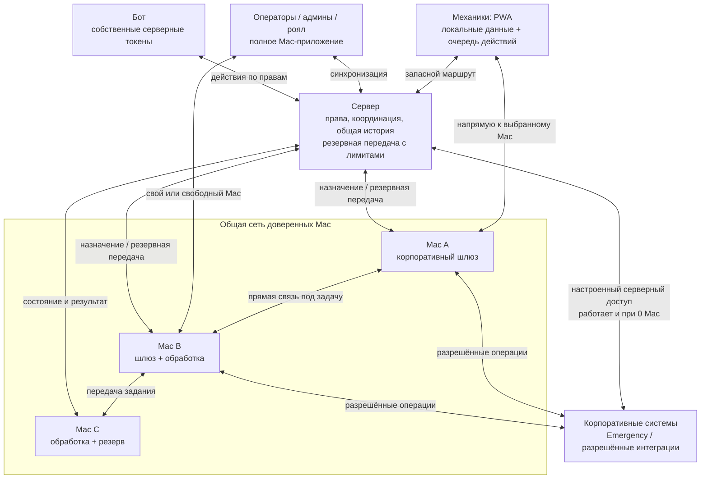

# Robopark: распределённая сеть сотрудников — целевая архитектура

Статус: **архитектура одобрена владельцем; реализация в тестовой ветке**, 15 октября 2026. Это расширение постановки владельца, не описание готового rc.2. Пользователь уточнил цель после реализации ограниченного compute: корпоративные ручки через приложения, чтение и разрешённая запись, механики в PWA, операторы/admin/royal на Mac, самобалансировка больших разнородных нагрузок и уменьшение зависимости от сервера. Выпуск только test/prerelease; production не изменяется. Мессенджер и VPN отложены.

## Обязательное уточнение: владелец устройства и корпоративная личность

Mac закреплён за одним владельцем. Другой сотрудник не может войти в Robopark на этом Mac под своей учётной записью. Выход из аккаунта, обновление или потеря связи не меняют владельца устройства. Привязка проверяется сервером по ключу устройства и приложением до принятия новой сессии; legacy-привязка восстанавливается по аутентифицированному каналу, а не по заявленному клиентом ID.

Корпоративные Emergency / SDC Inventory / Tracker выполняются под владельцем Mac. Оператор обслуживает себя и механиков своего активного парка в пределах их разрешений. Оператор не передаёт корпоративный запрос под другой учётной записью. Admin/royal работают только под собой. Балансировка сначала фильтрует устройства по владельцу, роли, парку и доступу к конкретной операции и лишь затем сравнивает ресурсы/связь. Общий доверенный вычислительный пул не означает общий пул корпоративных полномочий.

Цель установки — один интерактивный вход с дальнейшим поддержанием сессии. Подтверждение личности, OAuth-права, cookie-сессия и возможность обновления проверяются по документации каждого сервиса. Пароль не хранится; секреты остаются в Keychain владельца. Отзыв личного доступа и требование MFA приводят к повторному входу на Mac. Серверные интеграции и бот имеют отдельно настроенную служебную личность и работают независимо от наличия Mac. Отказ в личных правах не является поводом обходить его серверным токеном.

## Как понята цель
Robopark работает как единая сеть устройств. Mac совмещает рабочее приложение, корпоративный шлюз и исполнитель задач; его возможности зависят от текущего доступа и ресурсов. PWA механика — полноценный клиент той же сети. Устройство и маршрут выбираются автоматически. Сервер хранит общую авторитетную историю, права и координацию, но тяжёлые данные и корпоративные чтения по возможности идут между клиентом и Mac напрямую.

## Целевая схема (частично ещё не реализована)

Узлы рисунка показывают роли: приложение оператора может само быть Mac A/B/C. Не нужна постоянная полная связь каждого устройства с каждым. Используются выбранные соединения и небольшой резерв.

## Автовыбор и балансировка
Каждая работа имеет тип, требуемый доступ, объём, дедлайн, приоритет и правила повтора. Планировщик учитывает доступ к конкретной корпоративной системе, задержку/ошибки, скорость передачи, CPU/память/нагрев, занятость и историю выполнения этого класса задач. Срочные чтения, записи и тяжёлая фоновая обработка имеют отдельные очереди; справедливость по пользователям/паркам не позволяет одному клиенту занять всё.

Локальное действие выполняется локально, если это выгоднее. Для удалённого задания сначала прямой WebRTC, затем ограниченный серверный маршрут; деградировавший маршрут временно исключается и проверяется позже по спросу. При обрыве вычисление или безопасное чтение можно повторить на другом подходящем Mac. Не вся работа может мигрировать посередине исполнения; крупные операции нужно отдельно разбивать на части.

Серверный Wi-Fi разгружают локальное вычисление, прямые передачи, scoped-кэш и объединение одинаковых чтений, дельты вместо полных снимков, ограничение частоты/параллелизма и трафика relay. Если передача идёт через этот сервер, она использует его Wi-Fi: это невозможно устранить только выбором протокола.

## Записи и автономность
У действия постоянный ID, автор, парк/область, права и версия исходных данных. Действие и результат сохраняются в durable outbox/receipt. Внешние записи идут только через конкретные разрешённые операции с известным контрактом авторизации; endpoint или произвольный метод не приходят от клиента. Корпоративные cookie/credentials остаются на Mac.

После timeout записи нельзя считать ни успешными, ни невыполненными. Состояние outcome_unknown требует проверки результата во внешней системе; только подтверждённая возможность повтора допускает нового исполнителя. Конфликты изменений видны пользователю и сверяются по правилам конкретной сущности.

Первый режим отказа сервера: доступ к сохранённым данным и постановка действий в очередь на PWA/Mac; явно показаны актуальность данных и статус ожидающего действия. Следующий этап — краткосрочный подписанный кэш прав и уже установленные связи с известными Mac для разрешённых чтений во время сбоя координации. Для внешних записей начальный режим при потере сервера — очередь; автономное исполнение вводится отдельно по операциям, где есть идемпотентность и сверка результата. Длительная автономность требует репликации ограниченных данных, отзыва/срока прав, выбора координатора и разрешения конфликтов.

## Этапы
1. Общий typed gateway и каталог реально доступных операций на Mac; readiness отдельно по корпоративным сервисам; приоритеты/метрики/лимиты.
2. Прямой маршрут PWA/Mac → подходящий Mac и ограниченный relay с переключением; единый результат и статусы независимо от транспорта.
3. Durable команды/квитанции, дедупликация, сверка неизвестного исхода; локальные данные и восстановление очереди.
4. Краткая работа без сервера через известные узлы и ограниченный по времени кэш прав; затем выбор резервного координатора и выборочная репликация.
5. Оценка mesh/DHT после измерений: как искать узлы, отзывать права и управлять версиями данных. DHT сам по себе не решает эти задачи.

## Факт текущего rc.2
Mac умеет делегированное чтение Emergency robot payload и ограниченные image/CSV вычисления. Корпоративные cookie Emergency находятся в Keychain. Tracker использует центральный сервисный token. В коде есть и локальный склад Robopark, и отдельный внешний SDC Inventory (`services/sdc_inventory.py`: OAuth-чтение карточек и установок); предыдущий обзор ошибочно учитывал только локальный склад. Готового общего Mac-шлюза для Tracker/SDC Inventory нет. WebRTC в rc.2 используется для обработки фото; авторизация, выбор устройства и сигнализация требуют сервера. PWA/Mac имеют scoped offline snapshots/outbox, но это не подтверждает автономные внешние записи.

Новая автоматическая admission/relay разработка начата в ветке codex/automatic-hybrid-routing и ещё не выпущена. Включать её в описание опубликованного rc.2 нельзя.

## Уточнения владельца: корпоративная сеть, мессенджер и VPN
Корпоративная сеть Mac может блокировать UDP, STUN, прямой WebRTC, WebSocket или отдельные хосты. Для каждого узла отдельно проверяются доступность транспорта и доступность конкретной корпоративной операции. Порядок выбора — прямой разрешённый маршрут, затем доступный WSS/HTTPS relay, затем локальные данные/очередь. HTTPS 443 тоже не считается гарантированным. Потеря корпоративного доступа одним Mac переводит задания на другой готовый разрешённый Mac; отсутствие всех маршрутов не выдаётся за успех.

Мессенджер возможен как модуль поверх общей идентификации, шифрованной связи, локальной очереди, квитанций и доставки через доступные узлы. Потребуются отдельные правила ключей, групп, хранения и офлайн-доставки. Это пока идея, не функция релиза.

VPN — отдельный возможный сетевой модуль. На macOS packet VPN использует Network Extension/Packet Tunnel Provider с соответствующими разрешениями; существующий WebRTC data channel не создаёт системный VPN автоматически. Сначала нужен прикладной корпоративный gateway. VPN и mesh/DHT не реализуются скрыто в рамках текущей подготовки схемы.

Источники технологий: https://webrtc.org/getting-started/data-channels и https://developer.apple.com/documentation/NetworkExtension/packet-tunnel-provider .

## Обязательное уточнение: ноль Mac

Владелец отдельно подтвердил 15.10.2026: все сотрудники могут работать через сайт/PWA, Mac может не быть вообще, сервер сохраняет свои корпоративные доступы, бот — свои токены и штатные функции. Mac является дополнительным исполнителем и шлюзом, а не обязательным условием запуска системы.

Подробная матрица: [Режимы исполнения](2026-10-15-execution-modes.md). Чтения допускают настроенный серверный резерв при недоступности Mac/связи. Отказы в правах и повреждённые результаты не считаются недоступностью. Запись получает постоянную учётную запись и маршрут до отправки; после неизвестного результата исполнитель не меняется. Старые записи очереди сохраняют прежнего серверного автора.
