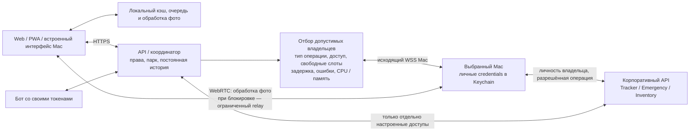

# Режимы исполнения Robopark

Статус: тестовая реализация `0.2.3-rc.3` в `codex/automatic-hybrid-routing`, по уточнению владельца от 15.10.2026. Production не меняется. Подтверждённые локальные проверки и ограничения полевой приёмки перечислены в `verification.json` комплекта.

| Ситуация | Чтение и работа | Записи и автор | Обработка фотографий |
| --- | --- | --- | --- |
| Ни одного Mac, сервер доступен | Полный сайт/PWA и настроенные серверные интеграции | Серверный корпоративный токен; журнал хранит пользователя Robopark | Локально на клиенте; без бесполезной отправки в пустой пул |
| Подходящий Mac доступен | Корпоративное чтение через Mac допустимого владельца | Выбор исполнителя и личности закрепляется до отправки | Локально; при необходимости прямой WebRTC на свободный Mac |
| Прямой канал блокируется сетью | Разрешённый HTTPS/WSS через сервер | Исполнитель записи остаётся прежним | Ограниченный relay после проверки исполнителя и бюджета |
| Mac выключен или потерял связь | Чтение использует настроенный серверный резерв | Начатая запись не переносится автоматически; проверяется исход | Другой вычислительный узел или локальная обработка |
| Сервер недоступен | Сохранённые данные с отметкой актуальности | Поддерживаемые действия сохраняются в локальную очередь | Локальная обработка; новый remote job требует координатора |
| Нет корпоративного доступа и готового Mac | Явная недоступность интеграции; остальная система работает | Очередь/требуется внимание; успех не имитируется | Независимые локальные операции продолжаются |

Сервер также может не иметь части доступов. Он не объявляется универсальным
исполнителем: наличие Tracker-токена не означает доступ к Inventory, а рабочая
сессия Emergency не даёт полномочий на Tracker. На Mac готовность и ёмкость
определяются по операциям. Ошибка одного маршрута не выключает всё устройство.

## Схема текущей тестовой реализации

Для корпоративных запросов сначала проверяются пользователь, роль, парк,
конкретный объект и владелец Mac. Среди разрешённых устройств выбирается
свободное: чтения имеют отдельную ёмкость от записей и вычислений. История
задержек и транспортных ошибок ведётся по паре `сервис:операция`; после
транспортного сбоя маршрут временно исключается, затем допускается проба.
Ошибки полномочий не разрешают переключать корпоративную личность.
Emergency использует собственный брокер чтений и readiness с теми же
ограничениями владельца. Это адаптивные измеряемые правила, без модели ИИ.

Например, Mac A может читать Tracker, Mac B — иметь рабочий Emergency,
а Mac C — только обрабатывать фото. Эти возможности независимы. Выбор
корпоративного Mac ограничен правами владельца; нельзя произвольно
использовать любой свободный ноутбук для личной ручки. Сервер подключается
только там, где настроен разрешённый резерв. Если все допустимые пути
недоступны, незавершённая работа остаётся видимой, а не получает ложный успех.

## Полномочия

Mac закреплён за первым подтверждённым владельцем. Он не принимает корпоративные credentials другого пользователя. Оператор исполняет запросы для себя и механиков своего активного парка; admin/royal — под собой. У всех запросов сохраняются текущие права Robopark и область конкретной задачи/робота. Общий вычислительный пул не передаёт корпоративные токены между устройствами.

Серверный режим — отдельная служебная интеграция. Отказ 401/403, 404, 429, нарушение схемы или подмена ответа не запускают автоматический переход на более широкие полномочия. Разрешённый fallback чтений реагирует на отсутствие готового узла и транспортную недоступность. Права сайта и PWA продолжают проверяться сервером.

Бот сохраняет собственный Telegram-токен и серверный корпоративный доступ. Его вызовы с сервисным токеном не превращаются в вызовы от имени случайного Mac. При переносе бывшего production Khadas старый бот остаётся выключенным: тестовый контур получает отдельный тестовый токен через настройки. Установщик не возвращает production-бота и production-домен.

Пользовательские экраны задач, роботов, блокеров, отчётов и первичная проверка
VIN используют разрешённый личный шлюз даже без серверного Tracker-токена.
Личные запросы обходят старый общий кэш служебной учётной записи. Фоновые
сборщики истории, уведомлений и кампаний остаются служебными интеграциями:
для их внешних запросов нужен отдельно настроенный серверный доступ.
Доступность пользовательского чтения через Mac сама по себе не включает
эти фоновые интеграции.

## Записи

У команды постоянный UUID, пользователь, объект и закреплённый исполнитель: конкретный Mac/владелец либо серверный корпоративный доступ. У каждого шага — digest и квитанция `executing/completed/unknown`. Квитанция сохраняется до внешней отправки. Повтор подтверждённого шага возвращает прежний результат; другой payload под тем же ID отклоняется. После обрыва нет автоматического запуска того же шага на другом Mac или сервере. Проверка маркера/состояния во внешней системе позволяет подтвердить уже совершённое действие.

Старые команды очереди закрепляются за серверным исполнителем, чтобы обновление не меняло их автора. Внешняя запись без известного исхода требует сверки; это не обещание exactly-once со стороны внешнего API.

На Mac журнал ограничивает число неподтверждённых шагов. После сохранения
результата сервер подтверждает квитанцию, и завершённая локальная запись
освобождает слот. Подтверждения повторяются при восстановлении соединения;
`executing/unknown` автоматически не удаляются. Серверная квитанция остаётся
для защиты от повторного исполнения.
Предел — 256 неподтверждённых локальных шагов. При заполнении возвращается
занятость; для действительно неизвестных исходов нужен отдельный будущий
протокол ручной сверки, они не удаляются ради освобождения места.

## Нагрузка и ограничения

На Wi-Fi сервера экономятся прямые передачи для обработки фотографий, локальное уменьшение файлов, объединение чтений и ограниченные relay-бюджеты. Передача через сервер по-прежнему расходует его канал. Корпоративные ответы текущего шлюза возвращаются через сервер, где проверяется область доступа; прямой корпоративный маршрут не следует приписывать реализации обработки фото. Нет mesh/DHT, VPN или распределённой замены авторитетной серверной БД.

Флаги тестовой конфигурации: `MAC_CORPORATE_GATEWAY_ENABLED` включает новый шлюз только в test-контуре, `MAC_CORPORATE_SERVER_FALLBACK_ENABLED` разрешает настроенный серверный резерв, `EMERGENCY_DIRECT_FALLBACK_ENABLED` разрешает серверную Emergency-сессию. Наличие флага не создаёт credentials или сетевой доступ. Production defaults не включают тестовый шлюз.
