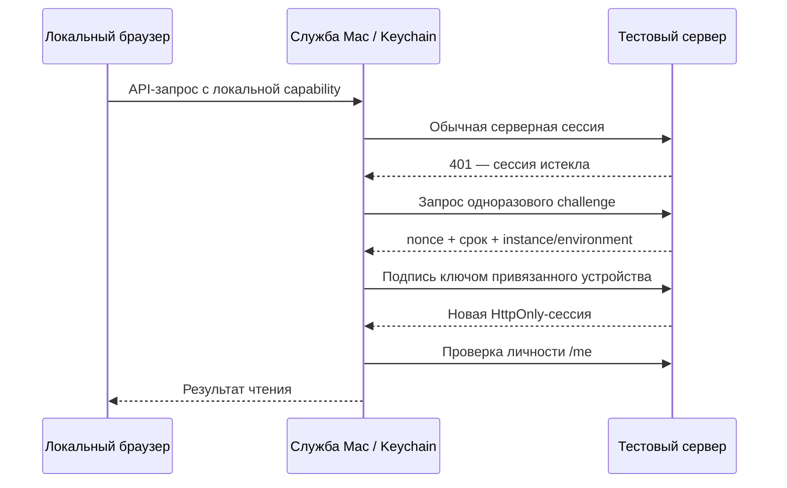

# Mac: сохранение входа и обновления

Проверка и решение: 16 октября 2026, тестовая линия 0.2.3-rc.9.

## Границы доверия

Владелец Mac входит в Robopark один раз и привязывает ключ P-256 устройства к
аккаунту. Пароль не сохраняется. Серверная сессия остаётся ограниченной по сроку;
после её истечения устройство подписывает одноразовый nonce с привязкой к
instance/environment/device. Challenge живёт 60 секунд, одноразовый, лимит выдачи
12/мин на устройство хранится в БД и общий для API workers. Браузер не получает
ключ, серверную cookie или корпоративные токены.

Выход из привязанной сессии, отзыв устройства, смена пароля или доступа отменяют
доверие. Старая сессия может прочитать уже существующую регистрацию, но не создать
новое доверие. Новая привязка требует парольного входа не старше десяти минут.
На обновлении RC8→RC9 автоматического backfill доверия нет.

Записи не переотправляются после неясного сетевого исхода. Временный отказ
продления сохраняет офлайн-профиль; отзыв доступа его не восстанавливает.
Root-терминал имеет отдельный step-up и срок. Корпоративный Passport/OAuth имеет
собственную сессию, MFA и отзыв: Robopark не отменяет требования провайдера.

## Keychain и подпись

Причина повторных запросов в RC8: ad-hoc подпись меняла designated requirement
бинарника. Новый TEST сертификат постоянен, его публичный SHA-256 находится в
`deploy/macos-test-signing.json`; закрытые файлы — только в
`.release-secrets/macos-test-signing/`, вне Git. Ключ требуется резервировать
в защищённом хранилище сборщика. Обычная сборка не генерирует замену: отсутствие
ключа или несовпадение отпечатка останавливает выпуск. Первичное создание доступно
только явным `ensure_test_signing_identity(..., initialize=True)`; менять pin для
обхода потерянного ключа нельзя, это новая миграция доверия.

Apple Developer ID и notarization пока отсутствуют. Постоянная TEST identity
решает преемственность Keychain, но не подтверждение Apple/Gatekeeper.

Фоновые Keychain-операции выполняются без UI. Недоступность старой записи является
ошибкой, не пустой регистрацией. Меню RP → «Подключить защищённое хранилище…»
выводит приложение вперёд и позволяет штатное разрешение macOS. Копирование из
`ru.robopark.agent` в `ru.robopark.agent.stable-v1` выполняется до использования
данных; сохраняются офлайн-ключ и индекс/квитанции корпоративных записей, включая
неизвестный исход. После частичного сбоя старые данные остаются. Полное удаление
учитывает оба namespace; обычное удаление сохраняет данные.

Stefania-Installer-v0.4.3.33 использован как справочный пример: системная утилита
Keychain, устойчивое хранение и разделение токенов. Клиентские ID, чужие токены и
права доступа не перенесены. Подтверждение существующей RC8 ACL может потребовать
одноразовое действие пользователя при миграции; новые версии с тем же сертификатом
не должны менять это доверие.

## Проверка и ограничения

Изолированные проверки: подпись двух различных сборок одним сертификатом и
доступ к одной фиктивной Keychain-записи; запрет иной identity; миграция/lock/
удаление в отдельной временной Keychain; runtime native session/loopback tests;
API challenge/replay/logout/пароль/доступ/межпроцессный лимит.

Живая проверка корпоративного входа, установленной RC9 и синхронизации фиксируется
отдельно в release `live-verification.json`. Сборочные тесты не заменяют эту
проверку и не доказывают вечный корпоративный SSO.
