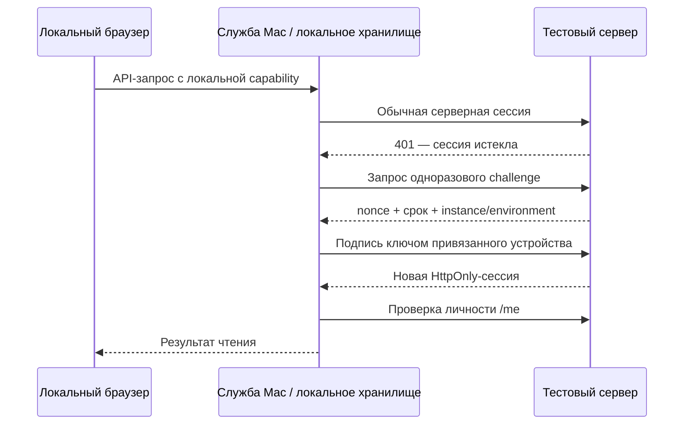

# Mac: сохранение входа и обновления

Проверка и решение: 16 октября 2026, тестовая линия 0.2.3-rc.12.

## Границы доверия

Владелец Mac входит в Robopark один раз и привязывает ключ P-256 устройства к
аккаунту. Пароль не сохраняется. Серверная сессия остаётся ограниченной по сроку;
после её истечения устройство подписывает одноразовый nonce с привязкой к
instance/environment/device. Challenge живёт 60 секунд, одноразовый, лимит выдачи
12/мин на устройство хранится в БД и общий для API workers. Браузер не получает
ключ, серверную cookie или корпоративные токены.

Выход из привязанной сессии, отзыв устройства, смена пароля или доступа отменяют
доверие. Старая сессия может прочитать уже существующую регистрацию, но не создать
новое доверие. Новая привязка требует парольного входа не старше десяти минут.
На обновлении RC8→RC9 автоматического backfill доверия нет.

Записи не переотправляются после неясного сетевого исхода. Временный отказ
продления сохраняет офлайн-профиль; отзыв доступа его не восстанавливает.
Root-терминал имеет отдельный step-up и срок. Корпоративный Passport/OAuth имеет
собственную сессию, MFA и отзыв: Robopark не отменяет требования провайдера.

## RC12: собственное хранилище сессий

Обычный запуск, сохранение сессии и обновление используют каталог
`~/Library/Application Support/RoboparkAgent/session-store-v1` текущего пользователя.
Каталог имеет права 0700, записи 0600. Запись атомарная, с межпроцессной блокировкой,
проверкой владельца и отказом от символьных ссылок. Бинарные ключи сохраняются без
текстового преобразования. Пароли пользователя не сохраняются.

Содержимое файлов не шифруется отдельным паролем: доступ ограничен учётной записью
macOS. Процессы того же пользователя и root могут его прочитать. Офлайн-снимки,
очередь и медиа сохраняют существующее AES-256-GCM; ключ теперь находится в этом
каталоге после переноса. Подпись приложения не участвует в чтении новых записей.

Keychain и неизменяемый broker остаются только источниками старых данных.
Миграция копирует данные и проверяет чтением, не удаляет оригинал. Если старую
авторизацию нельзя прочитать, интерфейс всё равно запускается и позволяет новый
вход. Старый офлайн-ключ и квитанции операций с неизвестным исходом при отказе
никогда не подменяются новым ключом/пустым индексом. До переноса старого ключа
офлайн-хранилище недоступно, онлайн-работа продолжается. Явный перенос доступен в
меню RP → «Перенести данные предыдущей версии…»; фоновые операции не открывают
системных запросов. Отзыв сессии или требование MFA провайдера по-прежнему требуют
входа. Обещание «никогда больше пароль» к этим случаям неприменимо.

Выход фиксирует маркер удаления, исключая восстановление прежней сессии.
Квитанции переносятся целиком до отметки завершения миграции; затем подтверждённые
квитанции можно удалять физически. Обычное удаление приложения сохраняет данные;
`--remove-data` удаляет также каталог RoboparkAgent текущего пользователя.

Исправлена загрузка SPA при запуске приложения по пути `/private/tmp`: существующий
корень ресурсов канонизируется до построения ещё не существующего маршрута.
Проверки выхода за каталог и символьных ссылок сохранены.

## История: Keychain и подпись RC8–RC11

Следующие разделы описывают прежнюю реализацию. Для новых записей с RC12 действует
собственное хранилище выше. Живая проверка RC11 показала отказ переноса старых
записей `-25293` даже при явном запросе, без появления системного окна.

Причина повторных запросов в RC8: ad-hoc подпись меняла designated requirement
бинарника. Новый TEST сертификат постоянен, его публичный SHA-256 находится в
`deploy/macos-test-signing.json`; закрытые файлы — только в
`.release-secrets/macos-test-signing/`, вне Git. Ключ требуется резервировать
в защищённом хранилище сборщика. Обычная сборка не генерирует замену: отсутствие
ключа или несовпадение отпечатка останавливает выпуск. Первичное создание доступно
только явным `ensure_test_signing_identity(..., initialize=True)`; менять pin для
обхода потерянного ключа нельзя, это новая миграция доверия.

Apple Developer ID и notarization пока отсутствуют. **Уточнение по живой проверке
16 октября:** постоянная self-signed TEST identity не обеспечила преемственность
login Keychain. Новая DEBUG и RELEASE сборки с тем же сертификатом и designated
requirement получают `-25293`; byte-identical копия RC9 по другому пути работает.
Изолированная Keychain этот отказ не воспроизводит. Поведение согласуется с
`cdhash` partition ACL для self-signed приложений в
[исходниках Apple Security](https://github.com/Apple-FOSS-Mirror/Security/blob/master/securityd/src/clientid.cpp).
Это исправление прежнего вывода, а не доказательство успешной миграции RC10.

Фоновые Keychain-операции выполняются без UI. Недоступность старой записи является
ошибкой, не пустой регистрацией. Меню RP → «Подключить защищённое хранилище…»
выводит приложение вперёд и позволяет штатное разрешение macOS. Копирование из
`ru.robopark.agent` в `ru.robopark.agent.stable-v1` выполняется до использования
данных; сохраняются офлайн-ключ и индекс/квитанции корпоративных записей, включая
неизвестный исход. После частичного сбоя старые данные остаются. Полное удаление
учитывает оба namespace; обычное удаление сохраняет данные.

Stefania-Installer-v0.4.3.33 использован как справочный пример: системная утилита
Keychain, устойчивое хранение и разделение токенов. Клиентские ID, чужие токены и
права доступа не перенесены. Подтверждение существующей RC8 ACL может потребовать
одноразовое действие пользователя при миграции.

## RC10: неизменяемый компонент хранения

Служба пользователя `ru.robopark.keychain-broker.v1` владеет отдельным namespace
`ru.robopark.keychain-broker-v1`. Основное приложение обращается к ней по XPC;
брокер не открывает TCP-порт. Проверяется подписанная личность клиента, а не
только PID или пользователь macOS. TLS, OAuth state, callback и проверка
владельца корпоративного аккаунта остаются обязательными.

Бинарник брокера подписывается один раз. Обычные релизы копируют ровно те же байты;
подпись, CDHash, SHA-256, исходники и публичный сертификат сверяются по manifest.
Повторная сборка/подпись v1 в обычном release запрещена. Изменение самого брокера
или переход на Developer ID требует отдельной версии и явной миграции.

Брокер не показывает Keychain-диалог в фоне. Миграция читает старую запись,
сохраняет её через брокер и проверяет чтением до использования; старые данные
не удаляются. Если macOS запрещает чтение старой записи, потребуется штатное
разовое разрешение через меню RP. Удаление создаёт устойчивый маркер, чтобы
оставленная legacy-запись не восстановилась после выхода. Обычное удаление
приложения сохраняет данные; `--remove-data` включает новый namespace.

Для квитанций корпоративных записей миграция сначала проверяет индекс и переносит
все его строки, затем фиксирует завершение переноса. После этого подтверждённые
квитанции удаляются физически, без накопления маркеров на каждую операцию; старые
копии больше не импортируются. Частичный перенос можно безопасно повторить.

Прототип прошёл проверку двух разных подписанных клиентов с одним брокером в
реальной login Keychain на фиктивных данных: чтение после смены сборки, удаление
без восстановления старой копии, отказ чужого клиента и брокера. Приёмка
окончательного подписанного бинарника и установленного приложения фиксируется
отдельно; тест прототипа не доказывает завершение миграции реальных сессий.

## Корпоративное окно входа

Два повторения входа показали блокировку главного перехода на
`guard.oauth.yandex-team.ru` после ввода пароля. RC10 заменяет список отдельных
узлов правилом HTTPS для `yandex-team.ru` и его поддоменов; Passport может
добавлять новые узлы без изменения приложения. Вложенные `about:blank/srcdoc`
разрешены только из доверенного корпоративного контекста. Проверки сертификатов,
точного OAuth callback, state и совпадения владельца сохранены. Диагностика
записывает только имя хоста, класс маршрута и числовой код — без query, fragment,
пароля, cookie и токена. До 48 событий доступны только Royal в памяти процесса.

## Проверка и ограничения

Изолированные проверки: подпись двух различных сборок одним сертификатом и
доступ к одной фиктивной Keychain-записи; запрет иной identity; миграция/lock/
удаление в отдельной временной Keychain; runtime native session/loopback tests;
API challenge/replay/logout/пароль/доступ/межпроцессный лимит.

Живая проверка корпоративного входа, установленной RC9 и синхронизации фиксируется
отдельно в release `live-verification.json`. Сборочные тесты не заменяют эту
проверку и не доказывают вечный корпоративный SSO.
